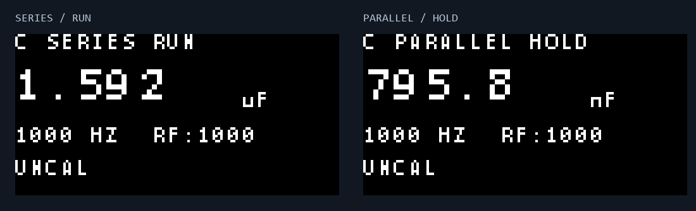

# 整机固件：操作、实现状态与验收

日期：2026-11-24（北京时间）。本文件描述当前 `firmware_next/`；前两轮离线记录保留为阶段历史。用户已批准继续完成固件，并指定：改用 F407 开发板后只有一个板载按键（接 WK_UP/PA0，高有效），OLED 改为正向摆放 0°，V1 输入由 PA0(ADC1_IN0) 改接 PC0(ADC1_IN10)。已在本机 Window 10/11 + arm-none-eabi-gcc 14.2 链接出 ELF/HEX/BIN，并用 ST-Link 烧入开发板（SWD 读回时钟/SysTick 验证启动）；尚未接模拟前端与 OLED 实测。未读取或修改旧应用实现。

## 引脚变化（开发板适配）

| 信号 | 旧板 | 开发板/当前固件 | 说明 |
|---|---|---|---|
| 按键 | PB1/PB2 两个按键 | **WK_UP/PA0**，高有效 | 内部下拉；按下为高 |
| V1（参考通道） | PA0 = ADC1_IN0 | **PC0 = ADC1_IN10** | PA0 被按键占用 |
| V2（测量通道） | PA1 = ADC2_IN1 | PA1 = ADC2_IN1 | 不变 |
| OLED 方向 | 旋转 180° | 正向 0° | `LCR_OLED_ROTATE_180=0` |

接线时需把 AFE 的 V1 输出从 PA0 移到 PC0；V2、继电器、I²C 等其余连线不变。AD9833 已失效移除，默认激励由 STM32 内部 DAC1 通道 2（PA5，PA4 对地 0 Ω 不可用）经 C1 注入；若恢复外部 AD9833，按 README 的接线更换后端并用 `-Ad9833` 重新构建，详见实施记录。

## 当前交付状态

完整源码已接通复位启动 → 板级初始化 → ADC/TIM/DMA → 测量/校准调度 → 单键/OLED → Flash 校准保存。电脑端 9 个 C 测试程序执行通过，23 个 C 源文件通过 Cortex-M4 / hard-float / O2 / `-Wall -Wextra -Werror` 编译。

**已链接出可烧录镜像。** `tools/rewrite/build_firmware.ps1` 在本机（Windows + `D:\Tools\embedded\arm-gcc-14.2`）实跑通过：`text 46832 / data 84 / bss 19056`，产出 `firmware_next/build-target/lcr-next.{elf,hex,bin}`，编译选项 `-O2 -Wall -Wextra -Werror` 零警告。此前记录的 WinError 623 属于旧机器环境问题，已不复现。

因此，启动/链接后的可用性、代码尺寸、真实中断时序、Flash 硬件掉电行为、模拟稳定性、测量精度及单次 ≤1 s 均未得到实物证明。源码与主机模拟接通不等于整机验收通过。

## 单个板载按键（WK_UP）

按键接 WK_UP = MCU PA0，高有效，固件开内部下拉；松开为低。旧板的 PB0/PB1 两个按键不再使用。

| 场景 | 短按（单击） | 长按（800 ms） | 双击（300 ms 内两次） |
|---|---|---|---|
| 测量主页面 | 启动/停止连续测量 | 进入设置菜单并停止测量 | 切换 SERIES/PARALLEL |
| 设置菜单 | 下一项 | 修改/确认当前项 | 返回测量主页面 |
| 校准确认页 | 取消 | 开始校准 | — |
| 校准进行中 | 取消并保留原校准 | — | — |
| 提示/报错页 | 重测（回测量页并立即开始） | 回设置菜单 | — |

消抖 25 ms，长按 800 ms，双击窗口 300 ms。短按要等双击窗口结束才上报，因此单击会有约 0.3 s 的判定延迟；长按结束后不再产生短按。上电已按住的键不会产生动作。这是普通操作键，不代替硬件急停。

串/并联切换不改频率、量程或采样状态，只从同一份 Z 选择 Rs/Rp、Ls/Lp、Cs/Cp。停止后保留最近一次有效结果并标记 HOLD。校准帧、错误帧和过期帧不会变成 DUT 测量结果。

## OLED

按现有资料实现 SSD1306、128×64、I²C1 PB6/PB7、400 kHz，尝试 7 位地址 0x3C 和 0x3D。控制器初始化依据 Solomon Systech SSD1306 数据手册，不能据地址应答认定兼容 SH1106。

`include/lcr_config.h` 中 `LCR_OLED_ROTATE_180=0`，OLED 正向摆放（0°）。所有页面共用同一帧缓冲与发送函数；发送时不做像素坐标反转，保持面板正向内容。屏幕故障时限定超时并尝试总线恢复，按键和测量调度继续工作，串口报告故障。采集期间不刷新 OLED，以减少显示总线干扰和延迟。

界面采用紧凑英文标签和 SI 单位：主页面显示 R/L/C、SERIES/PARALLEL、RUN/HOLD/SCAN、主数值、单位、频率、量程和校准标记。主数值行自动选最大可用字号：放得下时 3×（18×30 px 字符）且单位升到 2×，否则回退 2×；整行水平居中，标题与底部信息保持 1×。不可用 Q/D/Rp 等字段不当作零显示；微小负实部保留并显示 NEG-R。

下图直接取自 C 程序输出的帧缓冲；数值是同一组合成阻抗的串联与并联换算示例，不是实测数据。OLED 正向摆放，发送字节与图中一致（不再旋转 180°）。



[完整页面与反向发送数据预览](oled_preview.png)

## 测量与选频

- 自动模式按 1 kHz、10 kHz、100 kHz、100 Hz 做首次观察，在每个频点使用六档自动量程；根据信号有效性、等效类型和电抗幅度选取后续测量频点。该评分策略为待实测调整的初值，不保证所有复杂器件都能唯一识别。
- 对纯 R 优先保留 1 kHz 结果；对 L/C 优先选择电抗幅度接近 1 kΩ 的有效观察。无法获得有效结果时停止并提示，不制造正常数值。
- 每帧拟合后先检查 V1 基波峰值：低于 `LCR_EXCITATION_MIN_PEAK_CODES`（默认 25 码，约 20 mV 峰值）判为“无激励”，直接进入 `LCR STATUS` 提示页并显示 `NO EXCITATION` / `CHECK TP1 / DRIVE`，不显示测量数值。
- 连续测量时，如果频率和量程不变，保持激励并复用前端状态，不重复继电器动作和初始稳定等待。新结果的类型变化或阻抗变化超过两倍时，重新开始自动观察。
- 设置菜单可锁定四个频点中的一个，也可锁定六档量程中的一档。SERIES/PARALLEL 只决定报告的等效模型，不决定选频或量程。

切换量程仍遵守静音、先断后合、释放/吸合各 10 ms。普通测量默认启用自适应稳定判断：恢复激励后至少 20 ms，再间隔至少 20 ms 比较采样帧的两路直流值、相量幅度和复数阻抗；要求连续两次比较通过，过渡帧不发布。直流变化阈值暂为 0.2 ADC 码，幅度/阻抗相对变化阈值暂为 0.1%，总窗口上限 1200 ms。持续漂移会拒绝，削顶/量程不足走错误或换档流程。

这些阈值仅检查可观察信号的稳定度，不能证明模拟前端没有直流饱和，也不是精度认证。共用时钟的相位相关量化、噪声、缓冲器工作状态仍需实测。`LCR_ADAPTIVE_SETTLE=0` 可退回固定 800 ms 等待；校准采集始终使用这一保守等待。首次多频搜索和异常搜索可能超过 1 s；连续模式的改进不等于速度指标已经验收。

## 串口控制台（协议 v1，网页上位机）

USART1 PA9/PA10，115200 8N1。连上 CH340 后：

- 上电或发送 `?`：`$BOOT,1,<uid8>,0.5.0,1,<cal_level>,4,6*XX` + `$STATE,...`
- `M` 单次测量；`C1` / `C0` 连续测量开/关；测量完成发 `$RES,...`（|Z|、φ、Rs/Xs、类型、D/Q）。
- `F0..4` 频率（AUTO/100/1k/10k/100k），`R0..6` 量程（AUTO/10Ω…1MΩ），`S0/1` 串/并联。
- `CAL,CH` / `CAL,OPEN` / `CAL,STD,<µΩ>` / `CAL,SAVE` / `CAL,CLEAR` / `CAL,ABORT`；进度见 `$CAL`。
- `H` 帮助；`RESET` 软复位。帧格式与字段见 `docs/rewrite/网页上位机需求与接口.md` 第 4 章。

## 校准菜单

校准必须先停止测量，再通过单独确认页启动。所有参数先写入 RAM 工作副本；全部步骤通过才替换当前 RAM 参数。取消、超时、无效输入或三帧之间不稳定均保留原校准。

| 菜单 | 操作与效果 |
|---|---|
| CHANNEL CAL | 确认 DUT 断开；K1 将两路 ADC 接同源，四频点各采三帧，求 alpha=G1/G2，复制到该频点六个量程槽位 |
| OPEN CAL | 先完成通道校准；确认 DUT 断开，四频点×六量程各采三帧。当前没有物理短路残差测量，默认 Zs=0，页面明确显示 OPEN ONLY / ZS=0 |
| RF STANDARD | 选择一个量程，连接确认页指定的标准电阻，四频点各采三帧，估计该量程的有效 Rf/Cf。使用显示的标称标准值，因此精度包含标准件自身误差 |
| SHORT CAL:LOCKED | 显示未验证，不启动激励或保存参数。当前硬件的物理短路线性条件未确认 |
| SAVE CAL | 只有停止采集且激励软件状态为静音时才写入 Flash；校验成功才清除未保存标记 |
| CLEAR CAL | 经确认后只清除 RAM 参数；要永久清除，仍须执行 SAVE CAL |

更新通道校准后，该频点旧的反馈/夹具校准标记会失效。更新反馈校准后，该槽位旧的夹具校准失效，需重新开路校准。标准件求得的模型不合理、负有效电容或明显不稳定时拒绝；不会把不满足模型的数据强行拟合成有效校准。

开路记录不能冒充已经完成开路+短路校准；同源校准也不能冒充物理短路校准。高 Rf 下的寄生仍需要有效反馈标定，且不能由网表中的 NC 值推定实际寄生为零。

## Flash 与启动

新增独立 C 启动文件，复位时先调用早期 GPIO/FPU 初始化，再复制 `.data`、清零 `.bss`，进入主循环。向量表包含 SysTick、USART1 和 DMA2 Stream0，其他异常进入停止采样的故障等待。没有声称该故障路径能够保证外部激励已物理静音（DAC 后端在故障等待路径不会主动停 TIM6，尚未做真实故障注入验证）。

链接脚本只把前 256 KB Flash 用于程序，扇区 6/7 的两个 128 KB 区域保留为校准双副本；DMA 缓冲位于普通 SRAM，并设置链接断言禁止进入 CCM。预留 16 KB 栈；GNU 构建产生 `.su` 栈用量文件，最终仍需成功链接后检查全调用链、静态 RAM 和 Flash 总量。

保存时仅擦除非活动副本，写入新记录并完整读回校验，最后写提交字。序号支持回绕比较；新记录未提交或损坏时使用旧记录。读取失败禁止开始擦除。板卡编号取 MCU UID 的 32 位摘要；夹具编号由 `LCR_FIXTURE_ID` 指定，夹具改变时必须清除/重做校准并维护该编号。

NOR 模型测试覆盖每个擦除/编程操作边界的中断，不代替真实 Flash 电源跌落、最低工作电压或寿命测试。保存期间单 Bank Flash 擦写会阻塞取指和中断，故只允许停采集、静音后保存，不能当作测量中的后台操作。

## 编译与复现

项目根目录：

```powershell
# 本机已实际运行通过：9 个电脑端 C 测试程序
powershell -ExecutionPolicy Bypass -File tools/rewrite/check_host.ps1

# 本机已实际通过：23 个 Cortex-M4 源文件的逐文件目标编译
powershell -ExecutionPolicy Bypass -File tools/rewrite/check_core.ps1

# 完整构建入口（本机已验证可出 elf/hex/bin）
powershell -ExecutionPolicy Bypass -File tools/rewrite/build_firmware.ps1
# 可用的 GNU 工具链可通过 -Toolchain 指定其 bin 目录
```

成功构建的产物为 `firmware_next/build-target/lcr-next.elf/.hex/.bin/.map`。本机已用 arm-gcc 14.2 实跑通过（text 约 60 KB、-Werror 零警告），并已烧录到开发板验证启动与串口协议。

`check_host.ps1` 同时导出实际 C 帧缓冲的 PBM，`tools/rewrite/render_oled.py` 将其转为上述预览。字体和向量表可分别用 `make_font.py`、`make_startup.py` 重生成。

串口为 115200 8N1，保留中断接收环形缓冲。字符命令：`1`/`2` 等效短按，`b` 等效长按，`d` 等效双击，`s` 停止，`?` 帮助。串口服务用于调试，正常操作通过 OLED 和单键完成。

## 本轮测试证据

| 程序 | 主要检查 |
|---|---|
| core | 四频点、相量拟合、交错步长、校准方向、夹具模型与非法输入 |
| frontend | 72 条量程/CAL 路径，取消、回绕和通信失败 |
| measure | 32 组 R/L/C 完整帧，串并联参数与有效性标记 |
| session | 24 组 R 与 8 组 L/C 自动量程，过期/重复帧、超时和校准快照 |
| cal_store | 24 槽记录往返，1772 个字节位置翻转、全部截断长度、版本/上下文/非法值 |
| journal | 445 个中断写入边界、损坏回退、序号回绕、读失败不擦除 |
| ui | 单键消抖/长按/双击/回绕，串并联换算、正向与 180°映射（8192 像素） |
| app | 单键整机流程、R 与六组 L/C 自动选频、HOLD、三类校准、取消、不稳定拒绝和保存 |
| settling | 直流过渡帧拒绝、连续两次稳定比较、超时/回绕、连续测量不重复改频/继电器 |

平台 ADC/I²C/Flash/启动代码仅有目标编译证据，未模拟真实寄存器行为，也未执行 MCU 镜像。

## 上板后集中验收

1. 确认 U10 等实际型号、模拟供电/偏置和继电器实际触点；核对按键（WK_UP/PA0 高有效）与屏幕物理方向；确认 AFE 的 V1 已从 PA0 改接 PC0；逐档核对量程继电器接在 PD0+PD7/PD1/PD5/PD2/PD3/PD4 上且 PD6 为校准通路。
2. 确认启动默认反馈闭合、激励上电即输出（常开 1 kHz 正弦，100 Hz/1 kHz/10 kHz 可切，100 kHz 暂不承诺），TP1 约 0.5 Vrms（1.4 Vpp 正弦、直流偏置约 3.3 V）。
3. 观察原始 ADC 数据、同步性、削顶、DMA 完成/取消，比较实际采样率和模拟稳定门限。
4. 用标准件检验 R/L/C、串并联换算、自动选频/量程、重复性和每次测量耗时；根据实测调整门限与预算。
5. 实测两副本保存/重启/掉电恢复、屏幕断开和总线异常；确认异常不发布假读数。
6. 单独验证短路时的模拟工作状态，再决定能否开放物理短路校准。若固定硬件不支持有效短路观测，应记为能力缺口。

依据：[ST RM0090](https://www.st.com/resource/en/reference_manual/rm0090-stm32f407-advanced-armbased-32bit-mcus-stmicroelectronics.pdf)、[Solomon Systech SSD1306 原厂数据手册（Adafruit 托管）](https://cdn-shop.adafruit.com/datasheets/SSD1306.pdf)，以及用户指定的新网表和本仓库硬件核对记录。
