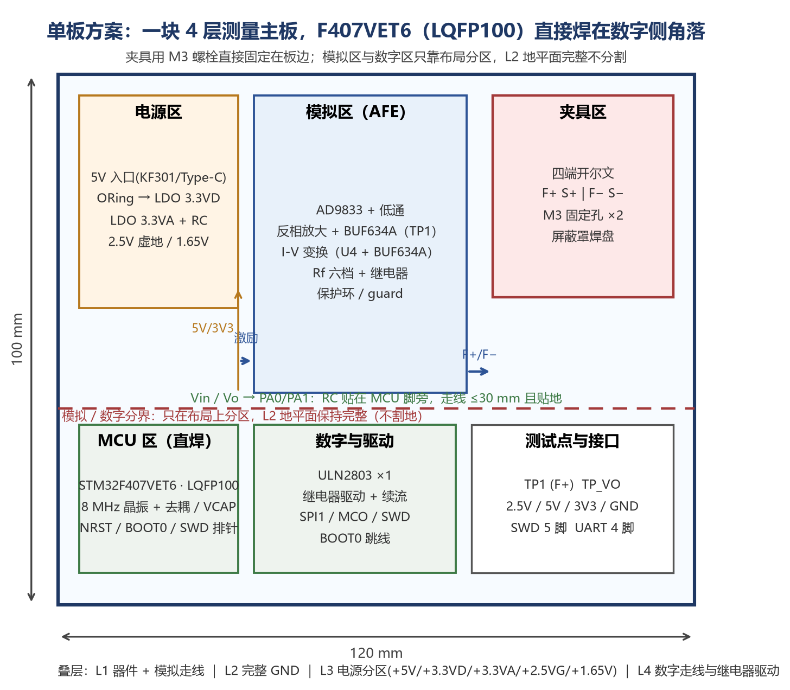

> ⚠️ **存档说明**：本文件是 4 层 / 分板阶段的方案记录。最新方案（单板 · 6 层 · 无星点接地）见 [`硬件设计-六层板.md`](硬件设计-六层板.md)，实施以那份为准。

# 硬件设计：单板方案（附分板备选）与四层板布局

> 适用对象：自动平衡电桥 RLC 测量装置（F407VET6 + AD9833 + 模拟前端）
>
> **最终决定（2026-11-12 修订）：画一块 4 层测量主板，F407VET6（LQFP100）直接焊在板上。**
> 理由见第 0 节。原第 1–6 节的"两块板"方案保留为备选参考，**不再执行**。

---

## 0. 为什么从"两块板"改成"一块板"

最初的出发点是"核心板以后能复用到别的项目"。但这个收益**不需要靠分板拿到**：

- 直焊 LQFP100 比买核心板便宜（芯片 ¥20 上下，核心板已经涨到 ¥60+），省下的钱够买 2–3 片备用芯片；
- 模拟部分脱离 MCU 本来就不能工作，所以"把模拟做成独立板"并不会提高复用性；MCU 也不值得为它单独做板——真正要复用的时候，拿这块板当数字平台即可。
- 分板唯一多出来的，是把 `Vin`、`Vo` 两个**毫伏级模拟信号**送过连接器，以及两块板之间的地电位差。

| 维度 | 单板（选定） | 两块板（放弃） |
|---|---|---|
| 噪声 | 一块完整地平面，模拟回流最短 | 模拟信号过排针，地弹与环路面积变大；100 kHz 下 1 mV 地差就是 0.2% 误差 |
| 夹具刚性 | 夹具用 M3 直接拧在板边，几何固定 | 需要额外支架，插拔/挪动会改变杂散，10 pF 档的 Cp 不稳定 |
| 调试 | 一个地参考，示波器探地简单 | 两块板地不同，探头夹哪都要想一想 |
| 成本/工期 | 少一块 PCB、少一组连接器、少一次装配 | 打样费差别可忽略，但装配与排错时间翻倍 |
| 成本 | 省掉核心板（现在涨价明显）：LQFP100 芯片 + 晶振 + 阻容约 ¥25–35 | 核心板 ¥60–90，且多一层排针接触 |

只有当"板框机械限制必须拆开"或"两个板已经画好、想并行调试"时，分板才值得。

### 0.1 单板平面（120 × 100 mm）



### 0.2 单板布局的五条硬规则

1. **模拟区在右上、数字区在左下**，中间留 15 mm 以上的"无人区"，L2 地平面**不分割**。
2. **核心板座在板边角落**，便于插拔；`Vin / Vo` 从 AFE 出来就近进座子的 PA0/PA1，`100 Ω + 1 nF` **贴在座子脚旁**，总走线 ≤30 mm 并全程有地回流。
3. **继电器线圈电流本地回流**：ULN2803 的地、续流二极管、线圈 100 µF 都放在数字侧，只在电源入口单点汇入主地。
4. **夹具贴板边**，四个焊盘到 AFE 的引线 ≤30 mm、成对绞合；夹具区四周留屏蔽罩焊盘与 M3 孔。
5. **电源区（KF301/Type-C + ORing + LDO）在最左边**，2.5 V 虚地与 1.65 V 偏置在模拟区内部单独铺铜，避免电源噪声直接进 AFE。

### 0.3 一上来就"定死"的接口（以后改版也不动）
|---|---|---|
| SPI1 | PA5(SCK) / PA7(MOSI) / PA4(FSYNC) | AD9833 |
| MCO | PA8 | 8 MHz → AD9833 MCLK（相干采样） |
| ADC | PA0(ADC1_IN0) / PA1(ADC2_IN1) | Vin / Vo，双 ADC 同步 |
| 串口 | PA9(TX) / PA10(RX) | 调试与数据 |
| SWD | PA13 / PA14 / NRST / BOOT0 跳线 | 调试与应急烧录 |
| 控制 | PD0–PD6 | 6 路量程继电器 + 1 路校准开关 |
| 指示 | PD12（LED） | 心跳 |

### 0.4 F407 最小系统清单（直焊版本，必须逐项画）

| 项目 | 器件/取值 | 接哪个脚 | 不做会怎样 |
|---|---|---|---|
| VDD 去耦 | 每个 VDD 脚一只 100 nF（0603，**紧贴引脚**）+ 全板 10 µF + 1 µF | VDD：11 / 19 / 28 / 50 / 75 / 100；VSS：10 / 27 / 74 / 99 | 168 MHz 下电源塌陷，程序随机跑飞 |
| VDDA 滤波 | 3.3 V → 10 Ω → 1 µF + 100 nF + 10 nF → VDDA；VSSA 直接接 GND | VDDA 22、VSSA 20 | ADC 噪声大、12 bit 只有 9 bit 有效 |
| VREF+ | 初版直接接 VDDA；预留 REF3030 焊盘 + 0 Ω 选择 | VREF+ 21 | 若 VREF+ > VDDA 会损伤芯片 |
| VCAP_1/2 | 各 2.2 µF 低 ESR（X5R/X7R）到 GND | 49 / 73 | 内核 LDO 不稳，MCU 无法启动 |
| HSE 晶振 | 8 MHz 20 ppm 贴片 + 2×10 pF（按晶振 CL 调） | PH0 12 / PH1 13 | 没时钟就跑不起来；MCO 也没法给 AD9833 |
| 复位 | 10 kΩ 上拉 3.3 V + 100 nF 到 GND + 排针引到 SWD | NRST 14 | 调试器接不上、干扰下自动复位 |
| BOOT0 | 10 kΩ 下拉 + 跳线到 3.3 V | BOOT0 94 | 没法用串口救砖 |
| VBAT | 接 3.3 V（或 CR1220 + 1N4148） | VBAT 6 | 悬空时 RTC/备份域异常 |
| SWD | 5 脚排针：3V3 / SWDIO(72) / SWCLK(76) / NRST / GND | PA13 72、PA14 76 | 烧不了程序（也可以用 UART 救） |
| UART | 3 脚排针：PA9(68) / PA10(69) / GND | — | 没有调试输出，等于瞎子 |
| ADC 入口 | `100 Ω + 1 nF` 紧贴 PA0(23) / PA1(24) | 23 / 24 | 采样瞬间电荷冲击直接变成噪声 |

**焊接建议**：LQFP100 是 0.5 mm 间距，最稳的是锡膏 + 钢网 + 加热台；没有加热台就四边拖焊 + 吸锡线清理。
先焊 MCU 再焊外围；**买 2–3 片备用**（¥20 左右/片，比核心板便宜得多）；焊完先量 3.3 V 与 GND 有没有短路，再上电。

---

## 1. 备选方案：两块板（已否决，仅存档）

```
            ┌─────────────────────┐        ┌──────────────────────────────┐
            │   F407 核心板        │  2×12  │        测量主板               │
            │  MCU + 晶振 + 去耦   │ 排针   │  AFE + 继电器 + 夹具 + 电源    │
            │  SWD + LDO + 复位    │◄──────►│  AD9833 + I-V + 量程电阻网络   │
            │  （可复用到以后的项目）│        │  四端开尔文夹具接口            │
            └─────────────────────┘        └──────────────────────────────┘
```

若将来真的必须分板，关键不在"分不分"，而在"模拟信号怎么过连接器"——见第 5 节五条硬规则。

---

## 2. 四层板叠层（测量主板）

| 层 | 名称 | 用途 | 备注 |
|---|---|---|---|
| L1 | TOP | 元件面 + 关键模拟走线 | 模拟区走线尽量在 TOP，下方紧贴完整地平面 |
| L2 | **GND** | **完整地平面（不分割）** | 模拟地/数字地靠布局区分，**不要割地** |
| L3 | PWR | 电源平面分区 | +5V / +3.3VD / +3.3VA / +2.5VG / +1.65V 各自一块铜皮 |
| L4 | BOTTOM | 数字走线、继电器驱动、guard | 不走模拟敏感信号；模拟区下方铺地铜 |

工艺（嘉立创 4 层常规）：板厚 1.6 mm、1 oz 铜、最小线宽/间距 0.15/0.15 mm、过孔 0.3/0.6 mm。100×100 mm 打样 5 片约 ¥50–80，比两板方案多花的钱可以忽略。

**核心板**：40×40 mm 左右，2 层也能做（底面整片地 + 每个 VDD 就近 100 nF）；如果你已经为四层板付了打样费，顺手做成 4 层更好（L2 完整地），成本几乎不变。

### 为什么"地不分割"

在 100 kHz、12 bit 的场景里，割地造成的**回流路径绕行**比"数字地污染模拟地"的危害大得多：回流被迫绕路 → 环路面积变大 → 更容易被 DDS/SPI 的边沿耦合。正确做法是：**地平面完整，用电源分区 + 元件分区 + guard 走线**来隔离。

---

## 3. 测量主板分区（俯视示意）

```
┌──────────────────────────────────────────────────────────────┐
│  [电源区]            [AFE 模拟区]              [夹具接口]      │
│  5V 入 / LDO         AD9833 → 低通 → 缓冲       四端开尔文     │
│  3.3VD / 3.3VA       I-V 变换 (虚地)            屏蔽罩焊盘     │
│  2.5V 虚地 / 1.65V   继电器 + Rf 量程网络                      │
│                                                              │
│  ─────────────────── 模拟/数字分界（guard 地线）────────────── │
│                                                              │
│  [继电器驱动]        [核心板插座 2×12]        [测试点 TP1/TP_VO]│
└──────────────────────────────────────────────────────────────┘
```

规则：
- 模拟区集中在板子一侧，**不要被数字走线穿过**；
- AD9833 放模拟区（它的输出直接进 AFE），它的 SPI 与 MCLK 从连接器方向进入模拟区边缘后立刻"止步"；
- 继电器线圈驱动（ULN2003/三极管）放数字侧，**线圈电流本地回 +5V，绝不进入模拟地**；
- 夹具接口在板边，四线尽量短（≤ 3 cm）且等长，屏蔽罩焊盘预留。

---

## 4. 核心板接口定义（2×12，2.54 mm）

| 针 | 信号 | 方向 | 说明 |
|---|---|---|---|
| 1 | +5V | 入 | 主板供核心板；若核心板自带 LDO 也可只给 5V |
| 2 | +3.3VD | 出/入 | 数字电源（建议由主板统一产生） |
| 3 | DGND | — | 数字地 |
| 4 | DGND | — | 数字地（至少 2 根） |
| 5 | +3.3VA | 出 | 核心板可用不到，留给 ADC 参考 |
| 6 | AGND | — | 模拟地（独立针） |
| 7 | V_in（激励采样） | 入核心板 → ADC | **两侧各配一根 AGND** |
| 8 | AGND | — | |
| 9 | AGND | — | |
| 10 | V_o（I-V 输出） | 入核心板 → ADC | **两侧各配一根 AGND** |
| 11 | AGND | — | |
| 12 | MCO_8M（PA8） | 出 | → AD9833 MCLK，源端串 33–100 Ω |
| 13 | DGND | — | MCO 的回路地 |
| 14 | SPI1_SCK（PA5） | 出 | → AD9833 |
| 15 | SPI1_MOSI（PA7） | 出 | → AD9833 |
| 16 | GPIO_FSYNC（PA4） | 出 | → AD9833 |
| 17 | DGND | — | SPI 回路地 |
| 18–21 | RELAY1..4 | 出 | 量程继电器控制（经驱动管） |
| 22 | NRST | 双向 | 可选，方便两板一起复位 |
| 23 | SWDIO/SWCLK（PA13/PA14） | — | 建议核心板自带排针，不必引到连接器 |
| 24 | +5V | 入 | 备用/双针降阻 |

要点：**模拟信号针的两侧必须是 AGND 针**（形成"地-信号-地"夹心），AGND 与 DGND 在连接器上各自成组，两板的 AGND/DGND 在**主板上单点汇合**（一般在 ADC 地或 LDO 地）。

---

## 5. 跨板模拟信号：五条硬规则

1. **信号夹地**：V_in / V_o 在连接器上左右各一根 AGND（上面表格已按此排布）。
2. **连接器正下方 L2 地必须完整**，不要在排针下方开槽；排针焊盘之间尽量铺地。
3. **核心板入口处加 RC**：R = 100 Ω、C = 1 nF 到 AGND（fc ≈ 1.6 MHz），既抗混叠又抑制排针耦合。代价是 100 kHz 处约 −0.2% 幅值、−3.6° 相位——**这部分被开路/短路/负载校准吸收**，不是问题。
4. **数字线远离模拟区**：SPI、MCO、继电器控制线走板边；与模拟走线平行长度 < 5 mm，交叉时垂直。
5. **ADC 侧去耦**：核心板上每个 VDD 100 nF；VDDA 磁珠 + 10 µF/100 nF/10 nF；VREF+ 与 VDDA 同点（预留 3.0 V 基准焊盘 + 0 Ω 选择）。

> 混叠提示：fs = 16·f₀，所以 **k·fs ± f₀ 处的噪声会直接折到测量频点**。数字边沿是宽带的，靠布局 + RC + 屏蔽来压，而不是靠 DFT 去滤。

---

## 6. 复用性设计

- 核心板固定：尺寸、排针位置、SWD、电源输入、晶振、复位电路一次做对，以后配不同底板；
- 把接口约定写进 `docs/接口约定.md`（引脚、电平、时序、命令），三人协作和换板都靠它；
- 底板打样时多打 2 套备用（4 层板打样便宜，焊接调试时坏一套很常见）。

---

## 7. 画板前检查清单

**F407 最小系统**
- [ ] VCAP_1(49) / VCAP_2(73) 各 2.2 µF 陶瓷到地
- [ ] 6 个 VDD（11/19/28/50/75/100）每脚 100 nF + 10 µF 体电容
- [ ] 4 个 VSS（10/27/74/99）多过孔接地
- [ ] VBAT(6) 接 3.3 V + 100 nF（不可悬空）
- [ ] VREF+(21) 与 VDDA(22) 同点，磁珠 + 10 µF/100 nF/10 nF，VSSA(20) 单点接地
- [ ] 8 MHz 晶振（12/13 脚）+ 负载电容（按晶振 C_L 算，约 10–14 pF）
- [ ] BOOT0(94) 10 kΩ 下拉；NRST(14) 10 kΩ 上拉 + 100 nF + 按键
- [ ] SWD 5 脚排针（PA13/PA14/NRST/3V3/GND）
- [ ] MCO 源端串 33–100 Ω

**测量主板**
- [ ] 2.5 V 虚地：分压 + 运放跟随（10 Ω + 10 µF∥100 nF 输出），不用裸分压
- [ ] 1.65 V ADC 中点：VDDA 分压 + 滤波 + 缓冲，独立于 2.5 V 虚地
- [ ] 继电器续流二极管 + 驱动管 + 线圈本地供电
- [ ] Rf 六档（10 Ω–1 MΩ）走线宽度：10 Ω 档按 50 mA 算，≥ 0.5 mm
- [ ] 四端开尔文接口：Force/Sense 分开，Sense 线不承载电流
- [ ] 测试点：TP1（激励）、TP_VO、2.5V、1.65V、AGND、DGND、+5V、+3V3
- [ ] 安装孔（M3 ×4）、屏蔽罩焊盘（模拟区上方）
- [ ] 模拟区与数字区之间留 guard 地线，并多打过孔到 L2

---

## 8. 待定事项

- 核心板尺寸与排针间距（2.54 mm 好插但占面积；1.27 mm 紧凑但难焊）——需要和结构/夹具一起定；
- 夹具是买现成四端夹具，还是自己画 PCB 夹具（后者可以和主板一体设计，一致性更好）；
- 层数确认：主板 4 层，核心板 2 或 4 层（建议都做成 4 层，同一批打样）。

